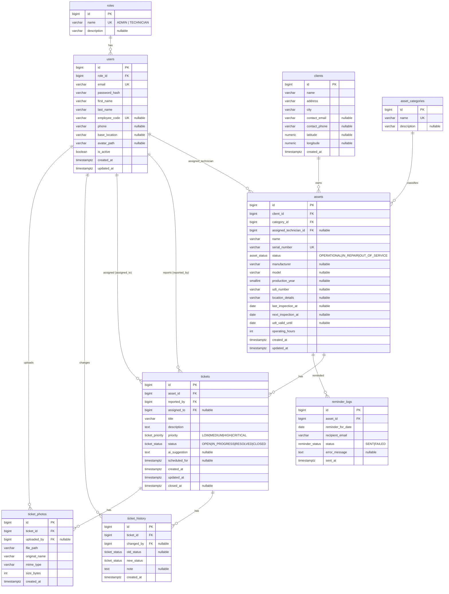

# AssetFix AI

System B2B dla firm serwisowych łączący panel menedżera z aplikacją mobilną technika, automatyzujący zarządzanie zgłoszeniami, planowanie tras oraz diagnostykę usterek przy wsparciu lokalnej sztucznej inteligencji.

## Funkcje

| Obszar | Co robi |
|---|---|
| Panel Menedżera (Desktop) | Zarządzanie harmonogramem, planowanie tras serwisowych oraz podgląd lokalizacji awarii na interaktywnej mapie. |
| Aplikacja Technika (Mobile) | Odbiór powiadomień, nawigacja GPS, raportowanie czasu pracy oraz bezpieczny upload protokołów PDF i zdjęć z terenu. |
| Inteligentna Diagnostyka (AI) | Analiza objawów wpisanych przez technika (model Ollama) i dopasowywanie historii z SQL w celu sugestii przyczyn i potrzebnych części. |
| Baza Wiedzy (Streaming) | Strumieniowe odtwarzanie (HTTP Range) wideo-instrukcji naprawy bezpośrednio w aplikacji dla techników. |
| Automatyzacja powiadomień | Skrypty CRON monitorujące terminy i rozsyłające automatyczne przypomnienia e-mail (obsługa przez Mailpit) o przeglądach okresowych. |

## Tech stack

| Warstwa | Technologie |
|---|---|
| Backend | PHP 8.3 (Architektura MVC, Autorski Routing, PDO/DAO) |
| Serwer HTTP | Nginx |
| Baza danych | PostgreSQL |
| Sztuczna Inteligencja | Ollama (Local LLM) |
| Aplikacje Klienckie | C# (.NET MAUI), Leaflet JS |
| Konteneryzacja | Docker Compose |

## Szybki start
```bash
git clone https://github.com/Rghjr/WDPAI-Project.git
cd WDPAI-Project
docker compose up --build -d
```

Aplikacja: http://localhost:8080

## Struktura projektu

- `/public` — Punkt wejścia aplikacji (`index.php`), arkusze stylów (`/css`) oraz pliki interfejsu (`/views`).
- `/src` — Główny kod źródłowy backendu, logika biznesowa, autorski routing oraz modele komunikujące się z bazą danych i modelem LLM.
- `/docker/db` — Skrypty inicjalizujące bazę PostgreSQL 16 (`01-schema.sql`, `02-seed.sql`, `03-logic.sql`).
- `docker-compose.yaml` — Orkiestracja kontenerów dla aplikacji, bazy PostgreSQL, serwera Nginx oraz usług pobocznych.
- `.env.example` — Szablon niezbędnych zmiennych środowiskowych i kluczy dostępu.

## Baza danych i diagram ERD

Schemat bazy PostgreSQL 16 znajduje się w katalogu [`docker/db/`](docker/db/) i jest automatycznie ładowany przy pierwszym starcie kontenera bazy danych:
- `01-schema.sql` — typy `ENUM`, 9 tabel relacyjnych, klucze obce (`ON DELETE RESTRICT` / `SET NULL` / `CASCADE`), ograniczenia `CHECK` i indeksy.
- `02-seed.sql` — dane demonstracyjne (role `ADMIN` i `TECHNICIAN`, 8 użytkowników z hashami bcrypt, 8 klientów z GIS, 6 kategorii, 15 maszyn, 20 zgłoszeń, historia, 6 metadanych zdjęć oraz logi CRON).
- `03-logic.sql` — widoki (`v_ticket_overview`, `v_upcoming_inspections`), triggery (`trg_ticket_status_history`, `trg_ticket_sync_closed_at`, `trg_*_updated_at`) oraz funkcje (`fn_open_tickets_for_technician`, `fn_create_ticket`).

> Uwaga: przy zmianie schematu w istniejącym środowisku należy zresetować wolumen bazy danych (`docker compose down -v && docker compose up --build -d`), aby skrypty z `docker/db/` wykonały się ponownie.



## Moduł projektów

Tabela `projects` jest tworzona przez idempotentną migrację `docker/db/04-create-projects.sql`. Po uruchomieniu aplikacji lista projektów jest dostępna pod `/projects`, a szczegóły rekordu pod `/projects/{id}`. W istniejącym wolumenie PostgreSQL migrację można zastosować bez resetowania danych:

```bash
docker compose exec -T db psql -U "$POSTGRES_USER" -d "$POSTGRES_DB" -f /docker-entrypoint-initdb.d/04-create-projects.sql
```

## Zasady developmentu

- Branch dla każdej funkcji.
- Małe, logiczne commity.
- Sekrety wyłącznie w .env.

## Autorzy

- Strzępek Krystian — Architektura backendu w oparciu o PHP MVC, konteneryzacja środowiska (Docker), integracja modelu językowego Ollama, budowa widoków responsywnych oraz konfiguracja bazy danych i routingu.
