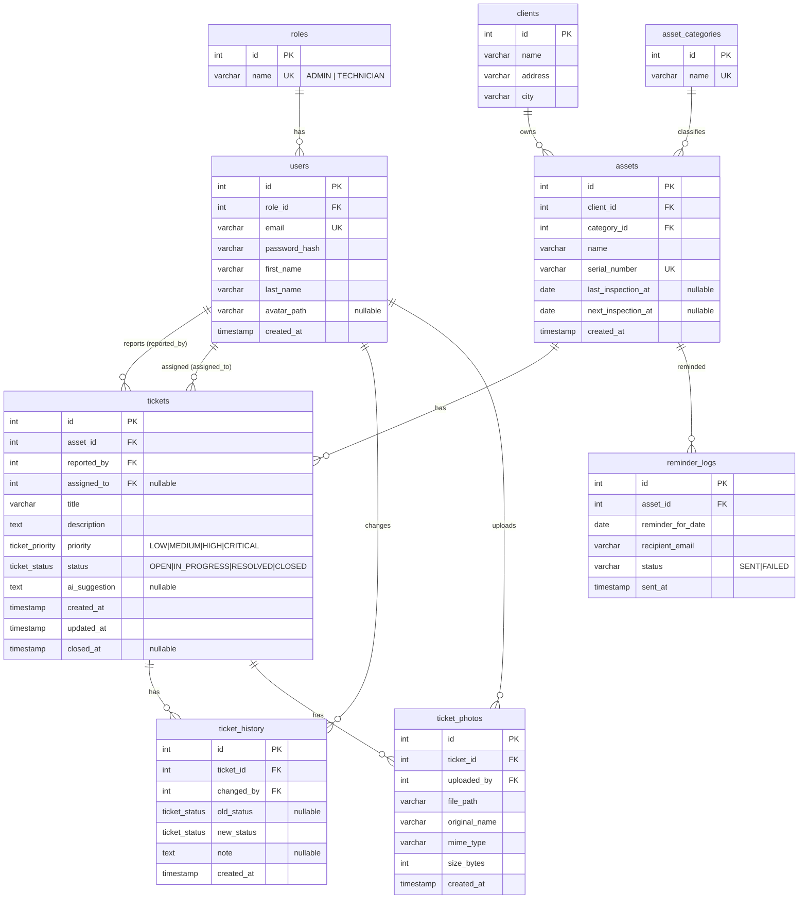

# Plan rozwoju i backlog — AssetFix AI

**Ostatnia aktualizacja:** 2026-10-27
**Źródło wymagań:** kryteria oceny projektu WDPAI (36 punktów) + założenia z `README.md`.

Ten plik jest lokalnym odpowiednikiem tablicy Trello. Sekcja 4 jest przygotowana tak, aby można ją było przenieść 1:1 na Trello (listy → karty → checklisty). Przy zamykaniu zadania aktualizuj status tutaj **i** na Trello.

---

## 1. Zakres aplikacji — co budujemy

### 1.1 Decyzja o zakresie

`README.md` opisuje wizję szerszą niż projekt zaliczeniowy (aplikacja mobilna .NET MAUI, streaming wideo HTTP Range, mapa Leaflet). Na potrzeby WDPAI realizujemy **aplikację webową w PHP**, która w całości pokrywa 36 kryteriów. Pozostałe elementy są oznaczone jako *poza zakresem* lub *opcjonalne* i nie blokują demo.

| Element z README | Decyzja |
|---|---|
| Panel menedżera (zgłoszenia, maszyny, przydzielanie techników) | **W zakresie** — rola ADMIN |
| Widok technika (moje zlecenia, zmiana statusu, zdjęcia) | **W zakresie** — rola TECHNICIAN, widoki mobile-first w tej samej aplikacji webowej |
| Diagnostyka AI (Ollama) | **W zakresie jako opcja** — endpoint Fetch POST; gdy Ollama niedostępna, serwis zwraca kontrolowany komunikat zamiast błędu |
| Powiadomienia e-mail (PHPMailer + Mailpit) | **W zakresie** |
| CRON — przypomnienia o przeglądach | **W zakresie** |
| Upload zdjęć/protokołów | **W zakresie** — zdjęcia (JPEG/PNG/WebP) do zgłoszenia |
| Mapa Leaflet | **Opcjonalnie** (po spełnieniu wszystkich kryteriów) |
| Aplikacja mobilna .NET MAUI | **Poza zakresem** WDPAI |
| Streaming wideo HTTP Range | **Poza zakresem** WDPAI |

### 1.2 Główny proces (demo end-to-end)

Jedno spójne demo, które pokazuje kryteria 8, 20–26, 15, 33, 34:

1. **Menedżer** (ADMIN) loguje się → dodaje maszynę do parku (`/assets`) → tworzy zgłoszenie awarii (`/tickets/add`) i przypisuje technika.
2. **Technik** (TECHNICIAN) loguje się → na pulpicie widzi swoje zlecenia → otwiera zgłoszenie.
3. Technik klika **„Diagnoza AI”** → Fetch POST do `/api/tickets/{id}/diagnose` → sugestia wyświetla się bez przeładowania (stan ładowania / sukces / błąd).
4. Technik **zmienia status** (Fetch POST) → trigger w bazie zapisuje wpis do historii → **uploaduje zdjęcie** naprawy.
5. Technik zamyka zgłoszenie → **PHPMailer** wysyła e-mail do menedżera (podgląd w Mailpit).
6. **CRON** raz dziennie wyszukuje maszyny z przeglądem w ciągu 7 dni → wysyła przypomnienie → loguje do `reminder_logs`.
7. Próba wejścia technika na `/admin/users` → **403**. Wylogowanie → „Wstecz” nie przywraca dostępu.

### 1.3 Role

| Rola | Może |
|---|---|
| `ADMIN` (menedżer) | wszystko: CRUD maszyn, zgłoszeń, użytkowników; przypisywanie techników; przegląd historii |
| `TECHNICIAN` (technik) | podgląd przypisanych zgłoszeń, zmiana statusu, diagnoza AI, upload zdjęć, edycja własnego profilu |

### 1.4 Model danych (docelowy ERD)

Mechanizmy bazy (kryterium 25):
- **Trigger** `trg_ticket_status_history` — przy `UPDATE tickets.status` wstawia wiersz do `ticket_history`.
- **Widok** `v_ticket_overview` — JOIN tickets + assets + clients + users (technik), używany na liście zgłoszeń.
- **Transakcja** — utworzenie zgłoszenia + pierwszy wpis historii w jednym `BEGIN/COMMIT`.
- **Funkcja** `fn_open_tickets_for_technician(user_id)` — liczba otwartych zgłoszeń na pulpicie.

Zachowania kluczy obcych (kryterium 26):
- `tickets.asset_id` → `ON DELETE RESTRICT` (nie usuwamy maszyny z historią awarii).
- `tickets.assigned_to` → `ON DELETE SET NULL` (zgłoszenie zostaje, technik odpięty).
- `ticket_history.ticket_id`, `ticket_photos.ticket_id` → `ON DELETE CASCADE`.
- `users.role_id` → `ON DELETE RESTRICT`.

### 1.5 Docelowa mapa tras

| Metoda | Trasa | Dostęp | Kryterium |
|---|---|---|---|
| GET | `/` | zalogowany | pulpit (różny dla ról) |
| GET/POST | `/login` | gość | 20 |
| POST | `/logout` | zalogowany | 24 |
| GET | `/tickets?status=OPEN&assigned=me` | zalogowany | 4 (query param) |
| GET/POST | `/tickets/add` | ADMIN | 8 |
| GET | `/tickets/{id}` | zalogowany (technik tylko swoje) | 4 (path param) |
| POST | `/tickets/{id}/status` | przypisany technik / ADMIN | 15 (Fetch POST) |
| POST | `/tickets/{id}/photos` | przypisany technik / ADMIN | 34 |
| GET | `/api/tickets/{id}` | zalogowany | 15 (Fetch GET, JSON) |
| POST | `/api/tickets/{id}/diagnose` | zalogowany | 15 (Fetch POST, Ollama) |
| GET | `/assets` | zalogowany | — |
| GET/POST | `/assets/add` | ADMIN | — |
| GET | `/assets/{id}` | zalogowany | — |
| GET | `/admin/users` | ADMIN | 22, 23 |
| GET | `/assets/serial/{serial}` | zalogowany | 4 (regex pattern, np. `[A-Z]{4}-\d{4}-\d{4}`) |
| GET | `/lang/{code}` | każdy | 30 |

---

## 2. Harmonogram (sprinty tygodniowe)

Semestr zimowy, start pracy 2026-10-27, prezentacja ok. końca stycznia 2027. Każdy sprint = 1 tydzień = 1–3 PR-y.

| Sprint | Termin | Cel | Epiki |
|---|---|---|---|
| S0 | 27.10 – 02.11 | Fundamenty: dokumentacja, naprawa Dockera, partiale | E0, E1 |
| S1 | 03.11 – 09.11 | Baza danych: schemat, seed, `.sql`, PDO, repozytoria | E2 |
| S2 | 10.11 – 16.11 | Logowanie, sesja, role, uprawnienia, wylogowanie | E3 |
| S3 | 17.11 – 23.11 | CRUD zgłoszeń i maszyn na prawdziwych danych, routing POST, 400/404 | E4 |
| S4 | 24.11 – 30.11 | JS + Fetch API (status, diagnoza AI), Ollama | E5, E6 |
| S5 | 01.12 – 07.12 | Upload zdjęć, PHPMailer, CRON | E7, E8 |
| S6 | 08.12 – 14.12 | Design, responsywność 5+ widoków, dark/light mode | E9 |
| S7 | 15.12 – 21.12 | Tłumaczenia PL/EN, WCAG + raport | E10 |
| S8 | 22.12 – 11.01 | Testy PHPUnit, refactor, czystość kodu, Security Bingo | E11 |
| S9 | 12.01 – 18.01 | Deploy, README finalny (zrzuty, ERD, konta demo) | E12 |
| S10 | 19.01 – 25.01 | Bufor, próba na czystym środowisku, poprawki | — |

---

## 3. Status kryteriów oceny

Legenda: ✅ spełnione · 🟡 częściowo · ❌ brak

| Nr | Kryterium | Status | Co brakuje / gdzie jest |
|---|---|---|---|
| 1 | README | 🟡 | brak zrzutów, ERD, przepływu, testów, deployu, kont demo |
| 2 | Docker | 🟡 | działa stos, ale brak `composer install` → fatal na czystym środowisku |
| 3 | Architektura | 🟡 | kontroler→widok OK; brak repozytoriów/serwisów |
| 4 | Routing | 🟡 | statyczna + `{id}` OK; brak POST, regex pattern, query param, 400 |
| 5 | OOP backend | 🟡 | klasy i typy OK; brak interfejsów między warstwami |
| 6 | ERD Mermaid | ❌ | tylko projekt w tym pliku, nie w README |
| 7 | Git | ✅ | 26 commitów, 9 PR z merge commit, bez squash |
| 8 | Realizacja tematu | ❌ | wszystko statyczne |
| 9 | HTML | 🟡 | semantyka OK; brak partiali, nagłówki powielone |
| 10 | PostgreSQL | ❌ | brak PDO |
| 11 | Złożoność bazy | ❌ | brak schematu |
| 12 | Eksport `.sql` | ❌ | — |
| 13 | PHP | ✅ | 8.3, strict_types, typy |
| 14 | JavaScript | ❌ | brak JS |
| 15 | Fetch API | ❌ | — |
| 16 | Design | 🟡 | tokeny CSS OK; style inline w `home`, `.container` niezdefiniowana |
| 17 | Responsywność | 🟡 | tylko `home`, 1 breakpoint |
| 18 | Dark/light | ❌ | — |
| 19 | WCAG | 🟡 | focus-visible OK; brak raportu |
| 20 | Logowanie | ❌ | tylko formularz |
| 21 | Sesja | ❌ | — |
| 22 | Uprawnienia | ❌ | — |
| 23 | Role | ❌ | — |
| 24 | Wylogowanie | ❌ | — |
| 25 | Widok/trigger/funkcja/transakcja | ❌ | — |
| 26 | Referencje | ❌ | — |
| 27 | Security Bingo | ❌ | — |
| 28 | Brak duplikacji | 🟡 | nagłówki/nawigacja powielone w 7 widokach |
| 29 | Czystość kodu | 🟡 | martwy `ProjectController`, `mealplanner.ini` |
| 30 | Tłumaczenia | ❌ | — |
| 31 | Testy | ❌ | — |
| 32 | CRON | ❌ | — |
| 33 | PHPMailer | ❌ | Mailpit w compose, brak kodu |
| 34 | Upload | ❌ | — |
| 35 | `.env` | ✅ | `.env.example` kompletny poza `PGADMIN_PORT` |
| 36 | Deploy | ❌ | — |

**Wynik dziś: 3/36 ✅, 12/36 🟡, 21/36 ❌.**

---

## 4. Backlog — struktura pod Trello

### Konfiguracja tablicy Trello

**Listy:** `Backlog` → `Sprint (Do zrobienia)` → `W trakcie` → `Review (PR otwarty)` → `Zrobione`

**Etykiety (kolor → epik):**
`E0 Docs` szary · `E1 Infra` niebieski · `E2 Baza` fioletowy · `E3 Auth` czerwony · `E4 CRUD` pomarańczowy · `E5 JS/Fetch` żółty · `E6 AI` zielony · `E7 Upload` turkusowy · `E8 Mail/CRON` różowy · `E9 UI` limonkowy · `E10 i18n/WCAG` błękitny · `E11 Jakość` czarny · `E12 Deploy` bordowy

**Konwencja karty:** tytuł = nazwa brancha w nawiasie + opis; w opisie karty numer kryterium; checklist = commity do wykonania. Po scaleniu PR karta → `Zrobione`, link do PR w komentarzu.

---

### E0 — Dokumentacja i proces (kryteria 1, 7)

- [x] **AGENTS.md + katalog docs/** — przewodnik dla agentów, inwentaryzacja, plan. Pliki lokalne (w `.gitignore`), bez PR.
- [ ] **[chore/gitignore-local-docs] `.gitignore`: AGENTS.md, docs/, uploads/, var/, *.log** — jedyna zmiana z tego zadania, która trafia do repo.
- [ ] **[docs/readme-structure] Rozbudowa README o wymagane sekcje** — puste szkielety: Konfiguracja (.env), Adresy usług, Konta demo, Przepływ, Architektura, ERD, Testy, Security Bingo, WCAG, Deploy. Wypełniane w kolejnych epikach.

### E1 — Infrastruktura (kryteria 2, 35)

- [ ] **[fix/composer-install-in-docker] `composer install` w obrazie PHP** — `RUN composer install --no-dev --optimize-autoloader` lub entrypoint; test na czystym klonie.
- [ ] **[chore/env-example-pgadmin-port] Dodać `PGADMIN_PORT` i zmienne DB/SMTP/Ollama do `.env.example`** — `DB_HOST=db`, `DB_PORT=5432`, `SMTP_HOST=mailpit`, `SMTP_PORT=1025`, `MAIL_FROM`, `OLLAMA_URL=http://ollama:11434`, `OLLAMA_MODEL`, `UPLOAD_DIR`.
- [ ] **[chore/php-ini-cleanup] Zmiana `mealplanner.ini` → `assetfix.ini`, rozsądne limity uploadu (np. 10M)**.
- [ ] **[chore/uploads-volume] Katalog `uploads/` poza `public/` + wolumen Docker + reguła Nginx do serwowania**.

### E2 — Baza danych (kryteria 10, 11, 12, 25, 26)

- [ ] **[feature/db-schema] Schemat PostgreSQL** — `docker/db/01-schema.sql`: typy ENUM, 9 tabel wg ERD, klucze obce z `ON DELETE`, indeksy, `CHECK`.
- [ ] **[feature/db-seed] Dane demonstracyjne** — `docker/db/02-seed.sql`: 2 role, 3 użytkowników (1 ADMIN, 2 TECHNICIAN, hasła `password_hash`), 3 klientów, 4 kategorie, 8 maszyn, 10 zgłoszeń, historia, 1 maszyna z przeglądem za 3 dni (dla CRON).
- [ ] **[feature/db-views-triggers] Widok, trigger, funkcja** — `docker/db/03-logic.sql`: `v_ticket_overview`, `trg_ticket_status_history`, `fn_open_tickets_for_technician`.
- [ ] **[feature/database-connection] Klasa `App\Database`** — singleton PDO, DSN z `.env`, `ERRMODE_EXCEPTION`, `FETCH_ASSOC`.
- [ ] **[feature/models] Modele domenowe** — `User`, `Role`, `Asset`, `Ticket`, `TicketStatus` (enum PHP), `TicketPriority` (enum PHP).
- [ ] **[feature/repositories] Repozytoria + interfejsy** — `UserRepositoryInterface`/`UserRepository`, `AssetRepository`, `TicketRepository`, `TicketHistoryRepository`; wyłącznie parametryzowane zapytania; JOIN-y przez widok.
- [ ] **[docs/erd-in-readme] ERD Mermaid w README** — zgodny z `01-schema.sql`.

### E3 — Uwierzytelnianie i autoryzacja (kryteria 20, 21, 22, 23, 24)

- [ ] **[feature/session-config] Bezpieczna sesja** — `session_set_cookie_params` (`httponly`, `samesite=Lax`, `secure` gdy HTTPS), start sesji w `index.php`.
- [ ] **[feature/login] Logowanie** — `AuthController::login` (GET/POST), `AuthService::attempt(email, password)` z `password_verify`, `session_regenerate_id(true)`, jeden komunikat „Nieprawidłowy e-mail lub hasło”, redirect na `/`.
- [ ] **[feature/logout] Wylogowanie** — POST `/logout`, `session_unset`, `session_destroy`, `setcookie` z przeszłą datą, nagłówki `Cache-Control: no-store` na chronionych stronach.
- [ ] **[feature/authorization] Uprawnienia po stronie serwera** — `AuthGuard`/middleware w routerze: `requireLogin()` → 401 lub redirect, `requireRole(ADMIN)` → 403; technik widzi tylko przypisane zgłoszenia.
- [ ] **[feature/csrf-protection] Token CSRF** — generowanie w sesji, ukryte pole w formularzach, nagłówek `X-CSRF-Token` w Fetch.
- [ ] **[feature/admin-users] Panel `/admin/users`** — lista użytkowników z rolami, tylko ADMIN.

### E4 — CRUD i routing (kryteria 3, 4, 5, 8, 9, 28)

- [ ] **[refactor/view-partials] Partiale** — `views/partials/head.html.php`, `header.html.php`, `nav.html.php`, `footer.html.php`; helper `e()` do escapowania; layout bazowy.
- [ ] **[refactor/remove-lab-leftovers] Usunięcie `ProjectController`, `projects.html.php`, `project.html.php`**.
- [ ] **[feature/router-improvements] Router** — obsługa `{param:regex}`, zwracanie 400 dla niepoprawnego `id` (np. `0`, za duży), 405 dla złej metody, przekazywanie query params.
- [ ] **[feature/tickets-from-db] Lista i szczegóły zgłoszeń z bazy** — `/tickets` z filtrem `?status=&assigned=me`, `/tickets/{id}` → 404 gdy brak.
- [ ] **[feature/ticket-create] Tworzenie zgłoszenia** — POST `/tickets/add`, walidacja serwerowa (`TicketValidator`), transakcja (ticket + history), komunikaty błędów przy polach.
- [ ] **[feature/assets-crud] Maszyny z bazy** — `/assets`, `/assets/{id}`, `/assets/add` (ADMIN), `/assets/serial/{serial}` (regex).
- [ ] **[feature/dashboard-from-db] Pulpit** — statystyki z `fn_open_tickets_for_technician`, zlecenia na dziś z widoku, różny dla ADMIN/TECHNICIAN.

### E5 — JavaScript i Fetch API (kryteria 14, 15)

- [ ] **[feature/js-modules] Struktura JS** — `public/js/app.js` (entry), `modules/api.js` (fetch wrapper: JSON, statusy, błędy), `modules/forms.js` (walidacja klienta), `modules/dom.js`.
- [ ] **[feature/client-validation] Walidacja formularzy po stronie klienta** — login, nowe zgłoszenie, nowa maszyna; komunikaty inline, `aria-invalid`, `aria-describedby`.
- [ ] **[feature/api-ticket-get] GET `/api/tickets/{id}` (JSON)** — `ApiController`, `Content-Type: application/json`, 404 JSON.
- [ ] **[feature/fetch-status-update] Zmiana statusu bez przeładowania** — POST `/tickets/{id}/status`, loader, toast sukces/błąd, aktualizacja DOM (badge statusu + wiersz historii).

### E6 — Diagnostyka AI (kryteria 8, 15)

- [ ] **[feature/ollama-service] `OllamaService`** — `OLLAMA_URL`, `OLLAMA_MODEL` z `.env`, timeout, prompt z opisem awarii + historią podobnych zgłoszeń (SQL `ILIKE`/`tsvector`), obsługa niedostępności (komunikat, nie wyjątek 500).
- [ ] **[feature/ai-diagnose-endpoint] POST `/api/tickets/{id}/diagnose`** — zapis `ai_suggestion` do bazy, zwrot JSON; przycisk „Diagnoza AI” w widoku ze stanem ładowania.
- [ ] **[chore/ollama-model-pull] Skrypt/instrukcja pobrania modelu** — `docker compose exec ollama ollama pull <model>`; opis w README.

### E7 — Upload zdjęć (kryterium 34)

- [ ] **[feature/photo-upload] `UploadService`** — limit rozmiaru z konfiguracji, `finfo_file` MIME (jpeg/png/webp), whitelist rozszerzeń, nazwa `bin2hex(random_bytes(16)) . ext`, zapis do `uploads/tickets/{id}/`, w bazie tylko ścieżka względna.
- [ ] **[feature/photo-gallery] Galeria zdjęć w szczegółach zgłoszenia** — `alt` z `original_name`, lazy loading, usuwanie tylko przez ADMIN/autora.

### E8 — E-mail i CRON (kryteria 32, 33)

- [ ] **[chore/phpmailer-dependency] `composer require phpmailer/phpmailer`** — `composer.lock` w repo.
- [ ] **[feature/mail-service] `MailService`** — SMTP z `.env` (Mailpit lokalnie), szablony e-mail w `views/emails/`, try/catch z logowaniem błędu.
- [ ] **[feature/ticket-closed-notification] E-mail po zamknięciu zgłoszenia** — do menedżera, z linkiem i podsumowaniem.
- [ ] **[feature/cron-inspection-reminders] Skrypt `bin/send-inspection-reminders.php`** — maszyny z `next_inspection_at` ≤ dziś+7, pomija już wysłane (`reminder_logs` z `UNIQUE(asset_id, reminder_for_date)` → idempotencja), log do `var/log/cron.log`.
- [ ] **[chore/cron-container] Usługa `cron` w compose** — obraz PHP + crontab `0 7 * * *`; instrukcja testu ręcznego `docker compose exec php php bin/send-inspection-reminders.php`.

### E9 — UI, responsywność, motyw (kryteria 16, 17, 18)

- [ ] **[style/design-system] Rozszerzenie tokenów** — typografia, odstępy, komponenty (button, badge, card, form, table, alert); usunięcie styli inline z `home`; zdefiniowanie `.container`.
- [ ] **[style/responsive-views] Responsywność 5+ widoków** — login, pulpit, lista zgłoszeń, szczegóły, maszyny, nowe zgłoszenie; breakpointy 480/768/1024; test braku poziomego scrolla.
- [ ] **[feature/dark-light-mode] Motyw** — skrypt inline w `<head>` (localStorage → `prefers-color-scheme` → `data-theme`), przełącznik w nawigacji, tokeny dla `[data-theme="dark"]`.
- [ ] **[style/desktop-layout] Układ desktopowy dla ADMIN** — sidebar + treść, tabele z przewijaniem poziomym w kontenerze.

### E10 — Tłumaczenia i dostępność (kryteria 19, 30)

- [ ] **[feature/i18n] Mechanizm tłumaczeń** — `src/i18n/pl.php`, `en.php`, `Translator::t('key')`, język w sesji + `/lang/{code}`, `<html lang>` dynamiczny; obejmuje komunikaty walidacji i błędów.
- [ ] **[refactor/extract-strings] Wyniesienie wszystkich tekstów z widoków i kontrolerów do katalogu tłumaczeń**.
- [ ] **[fix/wcag-audit] Audyt WCAG** — Lighthouse + axe na 5 widokach, naprawa: kontrast, `alt`, `label`, kolejność fokusu, skip-link, `aria-live` dla toastów.
- [ ] **[docs/wcag-report] Raport WCAG w README** — data, wyniki przed/po, zrzuty w `screenshots/wcag/` (katalog śledzony), lista naprawionych problemów.

### E11 — Jakość, testy, bezpieczeństwo (kryteria 5, 27, 28, 29, 31)

- [ ] **[chore/phpunit-setup] PHPUnit** — `composer require --dev phpunit/phpunit`, `phpunit.xml`, `tests/`, komenda `docker compose exec php vendor/bin/phpunit` w README.
- [ ] **[test/validators] Testy walidatorów** — `TicketValidatorTest`, `LoginValidatorTest`: przypadek poprawny i błędny.
- [ ] **[test/routing] Testy routera** — dopasowanie tras, parametry, 404/400.
- [ ] **[test/services] Testy serwisów z mockami repozytoriów** — `AuthServiceTest`, `UploadServiceTest`.
- [ ] **[refactor/dedupe] Przegląd duplikacji** — wspólne metody w `AppController`/repozytorium bazowym, brak powtórzonego SQL i HTML.
- [ ] **[refactor/code-cleanup] Czystość** — nazwy, krótkie metody, usunięcie debugów i komentarzy-tutoriali.
- [ ] **[docs/security-bingo] Security Bingo w README** — tabela: hashowanie haseł, parametryzacja, walidacja, kodowanie wyjścia, autoryzacja serwerowa, CSRF, bezpieczny upload, bezpieczna sesja, brak sekretów w repo, nagłówki bezpieczeństwa — każde pole z dowodem (plik:linia).
- [ ] **[chore/security-headers] Nagłówki w Nginx** — `X-Content-Type-Options`, `X-Frame-Options`, `Referrer-Policy`, podstawowe CSP.

### E12 — Deploy i finalizacja (kryteria 1, 36)

- [ ] **[chore/production-compose] `docker-compose.prod.yaml`** — bez pgAdmin/Mailpit, zmienne z env hosta, HTTPS (Caddy/Traefik lub reverse proxy platformy).
- [ ] **[chore/deploy] Wdrożenie** — VPS (np. Oracle Free/Hetzner/Mikrus) lub PaaS (Railway/Render + Neon/Supabase dla PostgreSQL); uploady na wolumenie; Ollama opcjonalnie (fallback komunikatu).
- [ ] **[docs/screenshots] Zrzuty ekranów** — `screenshots/*.png` (katalog w root, śledzony przez Git) z realnej aplikacji: login, pulpit, lista, szczegóły, diagnoza AI, upload, admin, dark mode, mobile.
- [ ] **[docs/readme-final] README finalny** — konta demo, link do deployu, opis przepływu, architektura (diagram warstw Mermaid), aktualny eksport `.sql` (`docker/db/dump.sql` z `pg_dump`), checklista oddania.
- [ ] **[chore/clean-env-test] Test na czystym środowisku** — klon do nowego katalogu, `cp .env.example .env`, `docker compose up --build -d`, przejście całego demo.

---

## 5. Zasady aktualizacji tego pliku

- Zaznaczaj `[x]` po scaleniu PR do `main`, nie po pierwszym commicie.
- Zmieniaj statusy w tabeli kryteriów (sekcja 3) w tym samym PR, który je zmienia.
- Nowe zadania dopisuj do właściwego epiku z nazwą brancha w nawiasie.
- Przesunięcia w harmonogramie zapisuj jako nowy wiersz „Zmiana planu” poniżej.

### Zmiany planu

| Data | Zmiana | Powód |
|---|---|---|
| 2026-10-27 | Utworzenie planu | start pracy nad dokumentacją |
